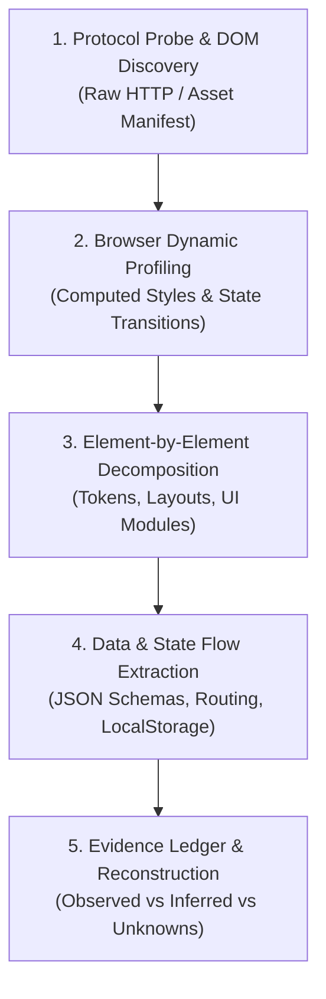

# The GATE Grind – REA Reverse-Engineered Prototype

> A high-fidelity, zero-dependency functional prototype of [The GATE Grind](https://thegategrind.online/) reverse-engineered and reconstructed using the **Reverse-Engineer Anything (REA)** framework in Google Antigravity.

---

## 🚀 Overview

This repository demonstrates how the **Reverse-Engineer Anything (REA)** methodology systematically analyzes an existing production web application—deconstructing its asset manifest, design tokens, interactive behaviors, and data schemas—to reconstruct an authentic, pixel-accurate local prototype without prior access to the target's source code or backend database.

---

## 🔄 REA Analysis Workflow & Process

The reconstruction followed a disciplined, evidence-based reverse-engineering pipeline:



---

### Step-by-Step Breakdown of the Process

#### 1. Protocol Probe & DOM Discovery (Raw HTTP / Asset Manifest)
- **Target URL**: `https://thegategrind.online/`
- **Method**: Lightweight HTTP inspection (`read_url_content`) to analyze the raw DOM prior to executing scripts.
- **Evidence Gathered**:
  - **Bundler Fingerprint**: Vite-generated hashes (`/assets/index-JTmGFAA4.js`, `/assets/jsx-runtime-B-8nPM94.js`, `/assets/index-DgDUOT9-.css`). Confirmed a client-rendered React SPA.
  - **Typography Profile**: Loaded via Google Fonts CDN:
    - `JetBrains Mono`: Primary monospace styling for headers, navigation, and body text.
    - `Jersey 10`: Retro 8-bit pixel font used for the headline accent (`ORGANIZED.`).
    - `Caveat`: Handwritten script used for sticky notes and callout cues.
    - `Inter Tight`: Condensed sans-serif for high-density badges.
  - **FOUT Prevention**: Inline `<head>` script inspecting `localStorage.getItem('pyq-gate-theme') === 'dark'` to prevent theme flashing on reload.

#### 2. Browser Dynamic Profiling (Computed Styles & State Transitions)
- **Method**: Headless browser automation (`browser_subagent`) to interact with the rendered application.
- **Evidence Gathered**:
  - Responsive layout constraints: `max-width: 1200px` for directory/catalog views; `max-width: 760px` for question practice views.
  - Hover states, CSS cubic-bezier transition curves, and neo-brutalist offset shadows (`8px 8px 0px #18181b`).
  - Interactive disclosure behavior of the answer accordion (`▶ Show answer and explanation`).

#### 3. Element-by-Element Decomposition
Every major UI component was individually cataloged, styled, and implemented:
- **Header & Navigation**: Monospace logo with animated terminal prompt cursor (`_`), pill navigation tabs with active contrast inversion, dual toggle switch (`LIGHT` / `DARK`), and `SIGN IN` pill.
- **Hero Section**: Deep charcoal (`#111111`) dot-matrix background (`radial-gradient`), tilted badge folders (`-12deg`, `-6deg`, `-8deg`), pixelated gradient headline, and a 23-branch ticker row.
- **5-Step Manifesto & Graph Paper**: Left column with the preparation philosophy; right column featuring a neo-brutalist graph-paper container (`16px 16px` grid) with 6 pastel interactive sticky notes.
- **Previous Years Directory (`/pyq`)**: Real-time branch search, alphabetical filter bar (`A` through `X`), and 2-column wireframe cards with paper counters.
- **Question Solver Engine**: Breadcrumb navigation, metadata pills (subject, topic, marks, question type), question stem, radio option grading (green/red feedback), and collapsible step-by-step worked solutions.
- **Retro Mascot Guide ("Gritty")**: Pixelated 8-bit SVG space-crab mascot with an interactive 4-step onboarding dialogue bubble, step counters, and skip/hide controls.

#### 4. Data & State Flow Extraction
- Abstracted the question and branch structures into clean JSON data contracts:
  - [`data/branches.json`](data/branches.json): Catalog of 22 GATE engineering disciplines with paper counts and alphabet groups.
  - [`data/questions.json`](data/questions.json): Real solved GATE examination questions with step-by-step explanations.
- Designed a zero-dependency client state controller in [`app.js`](app.js) managing active views, alphabet filtering, search queries, question grading, and theme persistence.

#### 5. Evidence Ledger & Reconstruction
All findings were categorized strictly into three tiers in [`docs/reverse-engineering-notes.md`](docs/reverse-engineering-notes.md):
- **Direct Observations (Facts)**: Exact fonts, DOM hierarchy, CSS variables, and localStorage keys.
- **Inferences (High Confidence)**: Static JSON data fetching and client-side routing.
- **Unknowns (Boundaries)**: Internal backend user authentication APIs and exact timed mock scoring algorithms.

---

## 📦 Project Structure

```
.
├── index.html                  # Semantic markup (Header, Hero, Manifesto, Catalog, Solver, Mascot)
├── styles.css                  # Custom design system, dark/light themes, neo-brutalist utilities
├── app.js                      # Application controller (theme toggle, search, solver engine, mascot tour)
├── server.py                   # Lightweight Python HTTP server with CORS & no-cache headers
├── package.json                # Project metadata and npm scripts
├── data/
│   ├── branches.json           # Catalog of 22 GATE engineering branches
│   └── questions.json          # Curated solved GATE questions with worked solutions
└── docs/
    ├── reverse-engineering-notes.md # Detailed observations, inferences, and architectural mapping
    └── learning-notes.md            # Educational walkthrough of the REA workflow
```

---

## ⚡ How to Clone and Run

### 1. Clone the Repository
```bash
git clone https://github.com/your-username/the-gate-grind-prototype.git
cd the-gate-grind-prototype
```
*(Or navigate to your local `d:/projects/rea` directory.)*

### 2. Run the Application

This project is built with **vanilla web standards** (HTML5, modern CSS, JavaScript ES6) and has **zero external package dependencies**. Choose any of the following options:

#### Option A: Using Python (Recommended)
Run the included lightweight server:
```bash
python server.py
```
Open your browser at:
```
http://localhost:3000
```

#### Option B: Using Node.js / npx
```bash
# Using npx serve
npx -y serve .

# Or using npm script
npm start
```

#### Option C: Direct Browser Launch
You can also open [`index.html`](index.html) directly in any modern web browser:
```bash
# Windows
start index.html

# macOS
open index.html

# Linux
xdg-open index.html
```

---

## ✨ Working Features

| Feature | Status | Details |
| :--- | :--- | :--- |
| **Theme Switcher** | ✅ Fully Functional | Seamless toggle between Light and Dark mode with `localStorage` persistence and sliding animation. |
| **Live Branch Search** | ✅ Fully Functional | Instant real-time filtering across 22 engineering branches by branch name, code, or keyword. |
| **Alphabet Filter Chips** | ✅ Fully Functional | Quick-jump filtering by letter (`ALL`, `A`, `B`, `C`, `D`, `E`, `I`, `M`, `P`, `S`, `X`). |
| **Question Practice Engine** | ✅ Fully Functional | Option selection, immediate answer evaluation (green/red), question navigation, and collapsible worked explanation. |
| **Hero Branch Selector** | ✅ Fully Functional | Interactive branch highlight that cycles disciplines on click. |
| **Interactive Sticky Notes** | ✅ Fully Functional | Hover animations and click-to-jump navigation to corresponding modules. |
| **Gritty, the Crab Mascot** | ✅ Fully Functional | Retro 8-bit SVG guide with interactive multi-step walkthrough dialogue. |

---

## 📖 Further Reading

- [Reverse-Engineering Notes (`docs/reverse-engineering-notes.md`)](docs/reverse-engineering-notes.md) – In-depth audit of observed assets, CSS rules, inferences, and architectural decisions.
- [Learning Notes (`docs/learning-notes.md`)](docs/learning-notes.md) – Step-by-step tutorial on applying REA tools, browser automation, and token mapping.
